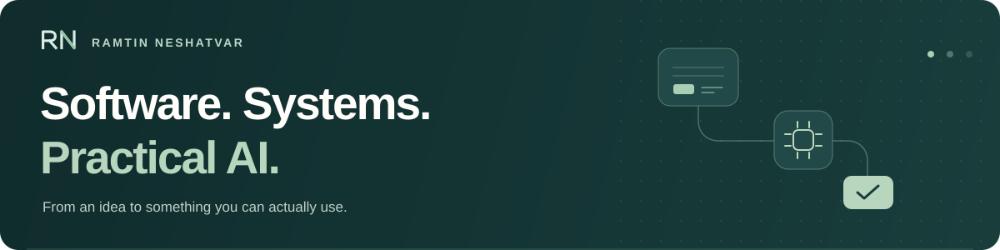

  

# Hi there, I'm Ramtin Neshatvar Ghaleh! 👋

**Computer Engineering Graduate | Freelance Web Developer | AI Workflows**

I'm a freelance web developer and **Computer Engineering graduate** from Islamic Azad University, Tabriz Branch. I work on web applications, interactive systems and practical AI workflows, with a product-minded approach and an interest in **IT Management**, **Digital Transformation** and human-computer interaction.

- 📍 Based in **Tabriz / Tehran, Iran**
- 🎓 **B.Sc. in Computer Engineering** — graduated **6 September 2026** · **GPA 17.10/20** · **146 Iranian credits**
- 💼 **Freelance web development and AI workflow projects**
- 🛠️ Working on **[Plivvi](https://plivvi.pages.dev/)** — a free, open-source document workspace, actively developed with AI assistance
- 🗣️ **Languages:** Farsi (Native), Azerbaijani (Native), English (C1 — IELTS Academic 7.5), Turkish (Fluent), French (Currently studying)
- 📄 **[Read my latest CV](https://ramtin-neshatvar.pages.dev/)** · [One-page version](https://ramtin-neshatvar.pages.dev/one-page/) · Available in English, فارسی and Français

---

### 🌐 Global Identity & Pronunciation
For my international and local colleagues, here is my full name and variations in my native script:
* **Full Name:** Ramtin Neshatvar Ghaleh (Persian: **رامتین نشاط ور قلعه**)
* **Commonly Known As:** Ramtin Neshatvar (Persian: **رامتین نشاطور**) or Ramtin Neshat (Persian: **رامتین نشاط**)
* **Alternative Spellings:** Ramtin Neshat-var, رامتین نشاط‌ور

---

### ✨ Active Open-Source Project

#### 📄 [Plivvi](https://github.com/ramt11n/plivvi) · [Open the app ↗](https://plivvi.pages.dev/)

**Role:** Developer · **Status:** Ongoing, actively maintained

A free, open-source document workspace for PDF tools, scanning, annotation, digital notebooks and comic reading. Built through **AI-assisted development (vibe coding)**, from UI/UX and implementation to debugging, testing and deployment.

* **Tech:** React, TypeScript, Vite, WebAssembly, Cloudflare Pages.
* **Features:** Merge and split PDFs, convert files, scan documents, annotate with a stylus, customize notebook paper and read comics.
* **Approach:** Browser-based document processing, responsive layouts, offline PWA support and RTL notebook layouts. Accounts and cloud connections are optional.
* **Ongoing work:** New features, usability improvements and bug fixes, with public source and community contributions on GitHub.

---

### 💼 Freelance Work & Project Experience

#### AI Workflow Collaboration · ASA Advertising Agency

**Past collaboration · August – November 2026 · Tabriz**

* Connected creative ideas, image/video generation, human review and editing into practical advertising workflows using ChatGPT, Claude and Higgsfield.
* Developed campaign concepts, refined prompts and evaluated generated visuals; coordinated the AI and Graphics team and supported colleagues with AI tools and day-to-day IT troubleshooting.

#### [Imen Pars Client Platform](https://github.com/ramt11n/imen-pars-shop) · [Live platform ↗](http://imenparstabriz.com)

**Freelance web development · December 2025 – Present**

* Designed and deployed a React/Vite platform with Node.js, Express, REST APIs and MySQL.
* Analysed factory workflows and modelled system requirements and inventory processes using UML.

---

### 🧠 Systems Engineering & AI

Projects exploring backend logic, mathematical visualisation and algorithm design.

#### 📡 [SignalSystemWeb](https://github.com/ramt11n/SignalSystemWeb)

**Role:** Product Owner & Developer

A bilingual (EN/FA) educational web app for visualising signals, Laplace transforms, convolution and linear time-invariant systems.

* **Tech:** React, Python/FastAPI, SymPy, Plotly, AI-Assisted Development.
* **Key Feature:** Combined an interactive React interface with mathematical processing, using AI assistance during implementation and prompt refinement.

#### 🔢 [Distributed-MNIST](https://github.com/ramt11n/Distributed-MNIST)

**Role:** Engineer

A distributed handwritten digit recognition engine using Python multiprocessing and a master-worker/MapReduce approach.

* **Tech:** Python, NumPy, multiprocessing.
* **Key Feature:** A neural network implemented from scratch without ML libraries, with **over 92% accuracy in project experiments**.

---

### 🎨 Frontend Engineering & Replications

A collection of educational projects focusing on component-based interfaces, responsive design, RTL layouts and recreating familiar products.

#### 🛍️ [GolestanCo-Clone-with_reactjs](https://github.com/ramt11n/GolestanCo-Clone-with_reactjs)

A React front-end project replicating the Golestan site architecture.

* **Focus:** Full component implementation, RTL layouts and responsive engineering.
* **Tech:** React.js, CSS.

#### 🏷️ [GoldTag](https://github.com/ramt11n/GoldTag)

A responsive front-end replication of Goldtag.net created for learning and practice.

* **Scope:** Four pages: Main, Login, Sign Up and Products.
* **Tech:** JavaScript, HTML, CSS (Responsive).

#### 🎬 [imd-b-Frontend-Clone](https://github.com/ramt11n/imd-b-Frontend-Clone)

A front-end implementation of IMDb’s main page.

* **Focus:** Responsive interface and movie data fetched from a practice API.
* **Tech:** JavaScript, HTML, CSS.

#### 🛒 [DigikalaProject](https://github.com/ramt11n/DigikalaProject)

Recreated Digikala’s main page using pure HTML and CSS.

* **Note:** An early layout-practice project built for MacBook screen sizes (non-responsive), without frameworks.

---

### 🎓 Academic Activities

* **Computer Engineering Scientific Association, IAU Tabriz** — operations coordinator and active member, **2023 – December 2025**. Organised departmental workspaces for student programming workshops.
* **11th RINOTEX Technology Exhibition** — presenter, **November 2023**, representing IAU Tabriz’s Computer Engineering Department and Scientific Association.

---

### 📜 Certifications

| Certification | Organization | Details |
| :--- | :--- | :--- |
| **React.js Development** | Tehran Institute of Technology (MFT) | December 2025 · 40 hours · **90/100** |
| **Web Design Pack** | Tehran Institute of Technology (MFT) | July 2025 · 150 hours · **85/100** |
| **IELTS Academic** | Istanbul · 9 November 2025 | **Overall 7.5** · Listening 7.5 · Reading 8.5 · Writing 7.0 · Speaking 6.5 |

---

### 🛠️ Technical Skills

* **Languages:** TypeScript, JavaScript, Python, Java, SQL.
* **Frontend:** React.js, Vite, HTML5, CSS3, Tailwind CSS, responsive design, RTL layouts, PWAs.
* **Backend & Data:** Node.js, Express, REST APIs, MySQL, FastAPI, NumPy.
* **Engineering:** Systems analysis, requirements analysis, process mapping (UML), algorithm design, multiprocessing and MapReduce.
* **Tools & AI Workflows:** Git/GitHub, basic Figma, ChatGPT, Claude, Higgsfield, AI tool orchestration, prompt refinement and image/video generation.
* **IT Support:** PC assembly, hardware diagnostics and operating-system configuration.
* **Interests:** Human-computer interaction, user interfaces, software engineering, information systems management and digital media workflows.

---

### 🤝 Connect with Me

  
  
  
  

  
  
  

  <a href="https://ramtin-neshatvar.pages.dev/">CV / Portfolio</a> ·
  <a href="https://www.linkedin.com/in/ramtin-neshatvar-185534263/">LinkedIn</a> ·
  <a href="mailto:ramtinneshat4@gmail.com">Email</a> ·
  <a href="https://t.me/Ramt11n">Telegram</a> ·
  <a href="https://www.instagram.com/ramt11n/">Instagram</a> ·
  <a href="https://x.com/rneshatvar">X</a>

